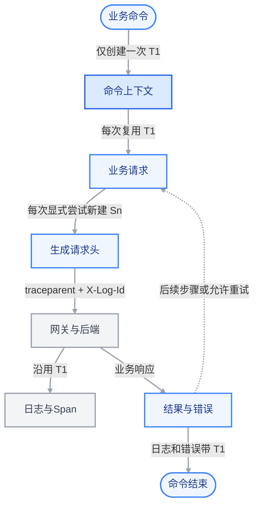

# contract-cli 命令级 Trace 修改计划与技术方案

初稿日期：2026-10-19。交付范围更新：2026-10-20，MR !20。

目标是对齐 makecli 的命令级关联行为：用户执行一次业务命令后，用一个 trace-id 查询该命令涉及的业务请求、重试和后端日志。

当前 MR 交付命令级 Trace、调试日志和取消修复：一次业务命令内共用一个 Trace ID，每次显式发送尝试生成独立 parent-id，保留底层 Client 的请求级兼容行为。源码所有构建与正式安装包均仅支持 prod，误传 `-tags dev` 也不能启用开发环境。上游摘要、review、审批矩阵及 Skill 同步能力继续沿现有调用链运行。

早期 dev 环境实现与只读联调仅作为本地历史保留在未推送的 `codex/local-dev-verification`（`6de2b57`），不在当前 MR 的源码能力与交付范围内。下文保留历史 Trace 证据及结论边界，不提供当前源码开启 dev 的入口。本次仅修改 contract-cli，未改后端。实施记录见[命令级 Trace 改造记录](ai-changes-command-trace.md)。

## 改造后的数据流

下图为命令级 Trace 的目标方案。蓝色节点为本次 contract-cli 改造，灰色节点为沿用的现有后端。



图中 T1 是一次 App.Run 的 trace-id，Sn 是每次 CLI 显式发送尝试生成的 parent-id。请求头为 `traceparent: 00-T1-Sn-01` 和 `X-Log-Id: T1`；T1、Sn 分别代表实际的 32 位、16 位十六进制 ID。下一次业务命令创建新的 T2。

命令出口将 T1 写入 stderr 日志和安全错误，业务响应体结构保持不变。底层自动重定向和透明重试维持原有行为；命令上下文不代表 CLI 已上报根 Span。

## 已验证的本地历史基线

本章的 dev 版本、profile、请求头组合和后端观察结果均来自本地历史验证，完整原始记录保存在 `codex/local-dev-verification`（`6de2b57`）。这些证据用于说明 Trace 兼容性，不表示当前 MR 支持 dev，也不替代当前 prod-only 源码的回归验收。

### 历史 dev 实际查询结果

2026-10-19 14:11:31 至 14:11:33（北京时间），使用当时本地版本 `1.9.2-beta.1-local.dev` 执行只读 `contract search`，样本为历史 profile `trace-dev`、user 身份、page-size=1、JSON 输出。

结果为退出码 0、HTTP 200、业务 `code=0`，返回 1 条结果。Trace ID 为 `6758775a7e738053d169d84e6a8b5702`。

| 位置 | 验证结果 |
| --- | --- |
| CLI | 请求开始和完成日志包含上述 trace-id |
| open-platform | 请求日志中的 traceparent 包含同一 trace-id |
| clm-openapi | 日志正文 MDC 标签 `X-Log-Id` 与 CLI trace-id 一致 |
| OpenObserve | 同一 trace-id 下可查询网关、clm-openapi 以及组织、鉴权、MDM 等下游服务的 Span |

该结果证明已测只读查询成功路径能够关联；其他命令、异常、重试和异步路径仍按后续验收清单检查。此次未修改后端。历史测试和验证记录见[本地 dev 历史记录](ai-changes-dev-trace-verification.md)。

### 请求头组合验证对比（dev）

验证日期：2026-10-19，时间均为北京时间。接口为 dev 的 POST /open-apis/contract/v1/mcp/contracts/search?user_id_type=user_id，请求体为 {"page_size":1}。下表五组均为只读查询成功样本，HTTP 200、业务 code=0，返回 1 条结果。

两个头同值组来自已安装 dev CLI；其余四组使用直接 HTTPS 请求绕过 CLI 自动注入逻辑，核对实际出站头，并用唯一 User-Agent、时间、路由及 OpenObserve 日志和 Span 对应请求。认证值与业务正文不写入文档。

实测结论：本次 dev 路径有有效 traceparent 时，网关与后端 Trace、已测日志 MDC 沿用其中的 Trace ID；没有 traceparent 时，由 Higress 建立新的 Trace。单独的 X-Log-Id HTTP 头不决定实际 Trace ID。

符号说明：T 为客户端 traceparent 中的 Trace ID，L 为客户端 X-Log-Id HTTP 头值，G 为 Higress 新建的 Trace ID。符号只用于各自行内比较，不代表不同场景共享同一个实际 ID。

| 请求头组合 | traceparent 中的 ID | X-Log-Id HTTP 头 | Higress / 后端 Trace ID | clm-openapi 日志 MDC X-Log-Id | 后端请求日志中观察到的 x-log-id HTTP 头 |
| --- | --- | --- | --- | --- | --- |
| 两个头同值 | T | T | T（沿用客户端） | T | T；已在 open-platform 请求头日志中确认 |
| 两个头都不传 | 未传 | 未传 | G（网关新建） | G | 未观察到该头；不等于证明线上不存在 |
| 只传 X-Log-Id | 未传 | L | G（新建，G ≠ L） | G | L，原值透传；与 MDC 不同 |
| 只传 traceparent | T | 未传 | T（沿用客户端） | T | 未观察到该头；不等于证明线上不存在 |
| 两个头不同值 | T | L（L ≠ T） | T（以 traceparent 为准） | T | L，原值透传；与 MDC 不同 |

#### 实际验证时间与 ID

| 请求头组合 | 验证时间（北京时间） | 客户端输入（仅列 Trace ID 部分） | 实际 Trace ID 与日志 MDC |
| --- | --- | --- | --- |
| 两个头同值 | 14:11:31 | 两个头中的 Trace ID： 6758775a7e738053d169d84e6a8b5702 | 6758775a7e738053d169d84e6a8b5702 |
| 两个头都不传 | 17:59:19 | 两个头均未传 | e2b5002926834398643f11e81d0d8c0b |
| 只传 X-Log-Id | 18:13:15 | X-Log-Id： 54fe43a5fd5e56d10a81bd323dfbf187 | cadc5d6b039b72b9f83592e30a41f908 |
| 只传 traceparent | 19:00:28 | traceparent： c25f5dcaa9b792bab994a0c24de53479 | c25f5dcaa9b792bab994a0c24de53479 |
| 两个头不同值 | 19:07:00 | traceparent： f041a5d8d2a755ef859be387bb517b5f；X-Log-Id： 7819c0b5419bf8ee2fc86040f9fca0a3 | f041a5d8d2a755ef859be387bb517b5f |

#### 结论与边界

- HTTP 请求头 x-log-id 与日志 MDC X-Log-Id 是两个不同位置。只传 X-Log-Id 或两个头冲突时，原 HTTP 头仍可见于后端请求日志，但 MDC 使用实际 Trace ID，不能据同名字段认定两者必然一致。
- 只传 traceparent 与两个头冲突两组均核对了远端 parent-id：Higress 首个已观测 Span 继承客户端 parent-id，下游核心 Span 父子关系连续。因此该网关 Span 不是完整 Trace 的根 Span。
- 未传 traceparent 的两组在已采集 Trace 中观察到 Higress 根 Span、无父引用；日志中的 MDC 与新建 Trace ID 一致。这不等于证明 Higress 另外注入了 X-Log-Id HTTP 请求头。
- 未观察到某个 HTTP 头，只表示已检索日志中未见，不作为线上请求头绝对不存在的证明；本次未定位具体 MDC 转换组件或核实全部服务的统一行为。
- 四组补充探测的响应均未回传 X-Log-Id 或 traceparent。最初两个头同值的 CLI 样本不纳入该响应头结论。
- 表中只采用业务成功且关键证据齐全的样本。只传 traceparent 组采用 19:00:28 的复测；18:56:32 首轮已确认 Trace 继承，但入口与 clm-openapi 日志未检索到，原因未确认，不作为该组 MDC 结论依据。
- 当前实现由 CLI 为一次命令生成一个 Trace ID，并在命令内复用；继续发送同 Trace ID 的 traceparent 与 X-Log-Id，保留现有兼容行为。仅传 traceparent 在本次路径已足以关联，不据此删除兼容头。
- 上述请求头组合验证发生在命令级 ID 改造前，当时该功能尚未实施；本组结果不增加后端改造范围。结论限于已测 dev 合同查询成功路径，不扩展到其他环境、接口、无效 traceparent、重试、异常或异步场景。

### import plan 多接口验证与 OpenObserve 时延（2026-10-20）

改造前基线：本节记录的 import plan 列头查询和规则行查询分别生成不同 Trace ID；后续已在 open-platform 的 HTTP Server Span 中找到两个原值，确认它们到达后端且保持独立。该次验证发生在命令级 Trace 改造之前。

#### 执行方法与客户端结果

2026-10-20 09:42:34.652 至 09:42:38.054（北京时间），使用本地 dev 版本 1.9.2-beta.1-local.dev（commit e7bb2bc）及独立 App profile trace-dev-app，针对已有矩阵 1178332302485226101 执行一次只读 import plan。自动更新检查已关闭；发现矩阵、预读列头等独立命令不计入本次两次业务请求。

该历史样本使用 contract/approve_matrix、矩阵 `1178332302485226101`、本地 JSON 测试输入与 JSON 输出；完整原始命令保存在上述本地分支，当前文档不提供 dev 复现入口。

命令退出码为 0，生成 status=needs_confirmation 的本地计划；两次 GET 均返回 HTTP 200。测试输入仅用于生成计划，未执行 apply；随后已用本地 import cancel 将该测试计划标记为 cancelled，取消操作未发业务请求。未修改矩阵数据、CLI Trace 实现或后端配置；原默认 profile 已恢复。

| 接口 | CLI 请求开始（北京时间） | Trace ID | HTTP | open-platform Span 数 |
| --- | --- | --- | --- | --- |
| 列头查询 /table_columns/column_headers | 09:42:35.736 | db99f5f3526ba88dccdac87a437b22e4 | 200 | 14 |
| 规则行查询 /table_rows | 09:42:36.892 | bbcce9bd4c6c20a407ee8d951d1d3bb8 | 200 | 15 |

后端 Server Span 分别为 GET fetch-rule-table-column-headers 与 GET retrieve-list-of-rule-table-rows，http_target 与上述目标矩阵的列头、规则行路径一致；本次规则行请求读取一页，page_size=100。确认范围为 open-platform，不把本次结果扩展成所有下游服务或日志 MDC 均已核对。

#### OpenObserve 查询与时延证据

首次精确查询窗口为 UTC 2026-10-20 01:42:30 至 01:42:50，即北京时间 09:42:30 至 09:42:50，覆盖两次请求；当时日志和入口 Span 未命中。后续在同一事件时间窗口、恢复原三个入口服务过滤后查到 29 个 open-platform Span（14 + 15）；扩大到 UTC 01:40 至 01:52 得到相同数量。因此，本次前后结果变化不能归因于时区换算、窗口过窄或仅服务名过滤不同。

| 请求 | Span 事件时间 _timestamp | 摄取处理时间 _o2_ingest_ts | 时间戳差 |
| --- | --- | --- | --- |
| 列头查询 | 09:42:37.083699 | 09:45:18.083396 | 160.999697 秒 |
| 规则行查询 | 09:42:38.232638 | 09:45:18.083578 | 159.850940 秒 |

记录中的摄取处理时间约为北京时间 09:45:18，比对应 Span 事件时间晚约 160 秒（约 2 分 40 秒）。结合原任务约 09:44 的查询时序及相同查询后来命中，证据支持首次查询偏早、这批可观测数据当时尚未完成摄取处理或尚未可查的解释。原精确 queried_at 未保存，因此不能还原首次可查询的精确时刻。

OpenObserve 官方源码在摄取处理中将 _o2_ingest_ts 赋为 now_micros，部分处理路径还会再次赋值。它不是 SDK 发送、Collector 接收、持久化完成或首次可查询时刻的精确记录。该官方源码版本未与当前部署核实一致；跨服务器时钟也未单独校准，表中差值作为时间证据，不当作单个组件的精确耗时。 [官方字段实现](https://github.com/openobserve/openobserve/blob/a70b3830163a41283138b43b3811bb451b9df8ea/src/core/src/traces/mod.rs#L198-L203)。

#### 结论、边界与后续验证

- 已确认的是摄取处理时间戳差及查询可见性变化；尚未定位 SDK、Collector、平台摄取、持久化或查询中的具体延迟环节，不将约 160 秒写成固定批处理配置或平台 SLA。
- 本次后端确认依据是 HTTP Server Span。open_platform 日志同时匹配 body/body_str 仍未命中，default 日志扩大窗口查询曾超时；未命中和超时均不作为日志 MDC 或请求头丢失的证明。
- 后续联调若请求刚完成便查询为空，先保留请求的事件时间窗口，稍后重查，并比较 _timestamp 与 _o2_ingest_ts；不要仅凭一次空结果认定链路断开。
- 当前实现由 CLI 在一次命令内复用同一 Trace ID，并发送同值的 traceparent 与 X-Log-Id。本次结果补强请求级现状和后端兼容基线，不改变仅修改 contract-cli、不安排后端改造的范围。
- 本章采用完整成功复测样本。前置授权码用户令牌的 403、首张候选矩阵的单元格类型缺失均另记于本地验证记录，不将这些失败样本当作 import plan 成功证据。原始业务响应与凭据不写入共享文档。

### 历史改造后 dev 复验（2026-10-20）

本地版本 `1.9.2-beta.1-local.command-trace.dev` 已安装（基于 e7bb2bc，包含工作区改动）。10:51:37.882 至 10:51:41.240（北京时间）用同一 dev 矩阵执行一次只读 import plan，退出码 0，生成 needs_confirmation 的本地计划；两次业务 GET 均 HTTP 200。

| 请求 | CLI 与后端共同使用的 Trace ID | open-platform Server Span ID |
| --- | --- | --- |
| 列头 table_columns/column_headers | f8b74b5419e878a91236da64356ab7db | 78967b5bdc6ef8f2 |
| 规则行 table_rows?page_size=100 | f8b74b5419e878a91236da64356ab7db | 1797282028bb9126 |

OpenObserve 在 UTC 02:51:30 至 02:52:00 的精确窗口中查到上述两个 HTTP 200 的 Server Span；查询时共观察到 open-platform 29 个、Higress 3 个 Span。验收确认两个目标请求共用命令 ID，不扩展为日志 MDC 或全部下游服务均已验证。测试计划已在本地取消，未执行 apply，后端代码及配置均未修改。

上述本地历史版本当时的默认/dev 全量测试、go vet、受影响模块 race 与独立审查均通过；两种构建合并 CLI 语句覆盖率为 80.23%。这是历史验证结果，当前 MR 的 prod-only 验收按下文重新执行。历史测试和复验明细见[命令级 Trace 改造记录](ai-changes-command-trace.md)。

### 改造前与当前 MR 实现

“逻辑请求”指一次 `Client.Do()` 或 `DoStream()` 调用；“发送尝试（attempt）”指 CLI 显式调用一次底层 `http.Client.Do()`，包括 CLI 控制的网络重试或 Token 刷新后的业务重放。

底层 HTTP 客户端的自动重定向和 Transport 透明重试可能在同一次显式发送中继续使用原请求头。本方案保留这些行为，parent-id 的刷新边界限定为 CLI 显式发送尝试。

| 场景 | 改造前 contract-cli | 当前 MR 行为 |
| --- | --- | --- |
| 同一命令调用接口 A、B | A、B 各自生成 trace-id | A、B 共用命令 trace-id |
| 同一逻辑请求重试 | 保持 trace-id，每次换 parent-id | 保持此行为 |
| 同一命令创建多个 Client | 各次逻辑请求分别生成 trace-id | 从命令上下文读取同一 trace-id |
| 同一进程连续执行两次命令 | 各次逻辑请求分别生成 trace-id | 每次 `App.Run()` 生成独立 trace-id |
| 用户附件上传 | prepare、commit 各有 ID；content 未接入这套头 | 三个阶段共用命令 ID，各阶段的显式发送使用独立 parent-id |
| 直接使用底层 Client，未进入 App.Run | 每个逻辑请求生成 ID | 保留请求级生成作为兼容处理 |

makecli 使用进程级懒初始化复用 trace-id；contract-cli 采用每次业务命令进入 `App.Run()` 时创建上下文的方式实现命令级关联，使同一进程多次执行命令时能够保持隔离。

## Trace 字段约定

继续使用现有请求头格式：

```text
traceparent: 00-<32 位 trace-id>-<16 位 parent-id>-01
X-Log-Id: <与 traceparent 相同的 trace-id>
```

W3C 将 trace-id 定义为整条 Trace 的标识，parent-id 表示调用方当前请求的标识；两者分别为 32 位、16 位小写十六进制，且均不能全零。参见 [W3C Trace Context](https://www.w3.org/TR/trace-context/#traceparent-header)。

| 字段 | 本方案中的职责 |
| --- | --- |
| trace-id | 标识一次命令的业务调用集合；命令执行期间保持稳定 |
| parent-id | 区分 CLI 显式发送尝试；继续由现有 Apply 方法每次重新生成 |
| X-Log-Id | 与 trace-id 保持同值，供日志关联 |
| 旧 logid、request-id、rid | 保留原有业务和日志含义，继续与 Trace ID 并存 |
| trace-flags | 沿用当前 `01`，本次不调整采样策略 |

示例中的 `T1`、`S1` 等仅代表符合上述格式的实际 ID：

| 执行步骤 | trace-id | parent-id |
| --- | --- | --- |
| 命令甲的接口 A 首次请求 | T1 | S1 |
| 接口 A 的允许重试 | T1 | S2 |
| 命令甲的接口 B 请求 | T1 | S3 |
| 命令乙的首次请求 | T2 | S4 |

Trace ID 仅用于可观测性。鉴权、租户边界、幂等判断和写操作结果确认继续使用各自已有机制。

## 命令上下文设计

### 在 App.Run 中创建和传递

在帮助、版本等本地分支处理完成后，仅为 contract、employee、department、payment、mdm、event、rule、review 业务命令创建新的 Trace 上下文，并将派生的 `ctx` 传给现有命令分发流程；同步更新 `a.commandContext`，使依赖该字段的认证和请求准备流程读取本次上下文。config/auth/skills/update 和环境诊断不新建业务命令 Trace。

每次进入业务命令的 `Run()` 都创建新 ID，包括复用同一个 App 实例再次执行命令的情况；进入前保存原 commandContext，所有返回路径通过 defer 恢复。传入的父 context 继续负责取消和超时，本次命令建立自己的 Trace 作用域。

在 `internal/tracecontext` 增加以下职责，复用已有随机数生成与非零校验，不批量重命名现有 `RequestTrace` 类型：

| 能力 | 行为 |
| --- | --- |
| 创建命令上下文 | 生成一次 Trace，使用私有 context key 保存；返回派生 context 或生成错误 |
| 读取上下文 Trace | 只读取当前作用域，不生成 ID，也不修改状态 |
| 解析请求 Trace | 有命令 Trace 时复用；未携带命令 Trace 时按现有逻辑生成请求级 Trace |

Trace 值随 context 显式传递，不引入新的进程全局可变状态或锁。实现使用局部派生 logger 记录命令边界、上传和下载阶段，不修改 App 的原 logger，避免 Client 的显式 trace_id 字段重复或后续命令残留。

### 统一客户端读取上下文

`Client.Do()` 和 `DoStream()` 共享“解析请求 Trace”的逻辑，替换目前各自直接调用 `NewRequestTrace()` 的位置。`doOnce()` 继续接收同一 Trace 值。

每个 CLI 显式发送尝试仍在请求准备 Hook 执行完成后调用 `RequestTrace.Apply()`，使最终出站的 `traceparent` 与 `X-Log-Id` 一致；调用方附加 Header 不改变本次命令的关联 ID。

现有控制流继续保留：只读网络重试次数、写请求不确定结果的判断、Token 过期识别、刷新次数以及流式请求体无法重放的处理均保持原有语义。`DoStream()` 沿用自己的认证和发送流程，本次只统一 Trace 的来源。

独立调用底层 Client 的代码可继续使用无命令 Trace 的 context。此时一次 Do 及其重试仍共享请求级 ID，两个独立 Do 之间不自动共享。

### 上传与签名下载

用户附件上传沿用现有 prepare、content、commit 流程：prepare 和 commit 自动从统一客户端继承命令 Trace；content 在现有上传 URL 校验完成后，将相同 Trace 应用到独立构造的请求。

content 上传继续使用其现有凭据与传输约束，不附加 profile 的 Authorization 或 Cookie；现有重定向、自动重试和上传结果不确定性规则保持不变。上传会话 URL、签名参数和文件内容不进入新增日志。

签名存储下载使用同一命令 ID 关联本地日志和错误。对存储地址的 Trace Header 注入不在本次范围，保持现有签名下载协议和凭据隔离。

### 命令日志与错误

命令入口、结束、失败、业务请求及上传/下载关键阶段的调试日志使用同一 trace-id。新增日志只包含安全的命令名称、阶段和错误类型，保留现有方法、接口路径及状态日志，不扩大请求体、凭据或个人数据的记录范围；未将全部既有日志统一改写。

2026-10-20 已补充 makecli 风格的日志开关：默认关闭内部诊断，--debug 开启；显式 --output json 或更新检查 --json 时，调试记录按 JSONL 写 stderr，其余为文本。Trace 生成和传播不依赖日志开关，stdout 业务结构保持原样。日志层采用每个 App 的稳定 handler 及可恢复的原子策略，认证和网络 guard 的既有 logger 引用不变。日志复验见 [CLI 调试日志记录](ai-changes-debug-logging.md)。

统一中断处理仅在显式 --output json 时将命令错误写为单行 JSON，其他模式保留 error 文本摘要；成功业务输出不变。取消退出 130；Run 在清空旧更新通知后检查父 context，并在自动更新检查后的分发边界再次检查，避免取消后继续认证或本地写入。更新检查自身超时仍可降级继续，非业务及内部命令保留取消错误链。取消与回滚点见 [中断及错误记录](ai-changes-interrupt-error-output.md)。

在命令错误出口补齐 Trace 信息，覆盖业务码错误和上传错误脱敏后的返回值。处理顺序为先执行既有错误翻译或脱敏，再附加安全的命令 ID。

复用现有 `TraceError` 与 `Unwrap` 机制，保持已有 `errors.Is/As` 判断；检查嵌套错误链，同一 ID 已存在时避免重复追加。已有脱敏逻辑不重新挂接未脱敏的原始错误。

本地参数校验或发包前失败也可以带命令 ID，但该 ID 只表示本地执行作用域，不能据此认定后端收到请求。

业务 JSON、YAML、表格和 `--raw` 输出保持原有结构。成功查询开启 --debug 后通过 stderr 日志获取 ID，失败信息携带 `trace_id=...`；本次不向业务响应体新增 Trace 元数据。

## 后端兼容与可见范围

后端继续从请求上下文继承 trace-id，每次 HTTP 请求创建对应的 Server Span。命令内多个请求使用同一个 ID 后，现有日志和 Trace 查询按该 ID 关联这些请求。

历史本地 dev 实测已确认 `X-Log-Id` 出现在 clm-openapi 日志正文，并能查询同一 trace-id 的 Span。是否存在独立的日志索引字段、是否所有服务都统一打印该标签，不作为本次已完成结论。响应头回传 `X-Log-Id` 可另行增强，本次验收以发送头、后端日志和 Span 的一致性为依据。

本方案延续 CLI 只生成传播头的实现，不引入 CLI OpenTelemetry SDK 或 Span 导出。OpenObserve 中同一 ID 下可能出现多个请求入口段；如需展示覆盖整条命令的 CLI 根 Span 和完整客户端耗时，再单独设计 SDK、根 Span 与导出配置。

OAuth 注册与换取凭据、自动更新等独立 HTTP 通道保持既有路径，本次不扩展这些请求的 Trace Header 注入。

## 交付修改范围

| 文件或模块 | 交付内容 |
| --- | --- |
| internal/tracecontext/tracecontext.go | 增加命令上下文存取和请求级兼容处理，复用现有生成器与 Apply |
| internal/cli/app.go | 每次 Run 创建并传递命令上下文，更新 commandContext，收口命令出口 |
| internal/cli/command_trace.go | 新增命令日志与错误关联的局部辅助逻辑，保持职责集中 |
| internal/cli/debug_logging.go、execute.go、输入读取与进程入口 | 默认静默、显式调试日志、结构化错误及 Ctrl+C 取消；更新检查取消后停止后续分发 |
| internal/openplatform/client.go | Do、DoStream 读取上下文 Trace，保持 CLI 显式发送尝试级 parent-id 生成 |
| internal/cli/contract_upload_mcp_command.go | content 请求接入 Trace；上传阶段日志与脱敏错误保留关联 ID |
| internal/cli/contract_download_mcp_command.go | 签名下载的本地日志与安全错误关联命令 ID |
| internal/cli/command_support.go、contract_mcp_response.go、directory_command.go | 回归核对业务码错误、输出和已有脱敏包装与统一命令出口的兼容性 |
| 对应 tracecontext、openplatform、CLI 测试 | 覆盖命令隔离、多请求复用、重试、流式、上传、取消及所有构建的非生产拒绝场景 |
| README、命令文档、测试计划及需求变更记录 | 将粒度说明更新为命令级，保留底层 Client 的请求级兼容说明 |

业务命令和 domain service 继续沿既有 ctx 与共享 Client 调用链传递，保留最新 master 的摘要、review、审批矩阵原生 ID 与 Skill 同步行为。dev 环境预设、构建开关及放行逻辑从当前 MR 删除；环境校验恢复为所有构建严格仅 prod。本次实施范围仅包含 contract-cli，后端代码、配置、数据库表结构和业务接口字段保持不变。

## 实施状态与交付边界

| 步骤 | 内容 | 状态与交付 |
| --- | --- | --- |
| 第一阶段 本地历史基线 | 曾在本地 dev 版本执行只读查询，核对后端日志和 Span | 历史证据保留；dev 实现仅存未推送的本地分支，不交付到当前 MR |
| 第二阶段 A 测试先行 | 增加同一命令多次请求共用 ID、两次 Run 使用不同 ID 等测试，确认旧实现失败 | 已完成；旧 import plan 用例因 ID 不同失败，上传 content 缺头等用例先红后绿 |
| 第二阶段 B 最小实现 | 增加命令上下文和统一客户端读取，补齐上传与错误关联 | 已完成；无命令上下文保留请求级兼容，未增加锁或 SDK |
| 第二阶段 C 回归与审查 | 验证所有构建严格仅 prod，以及错误类型、输出兼容、脱敏、取消和共享调用链 | 当前 MR 按下节验收；历史 dev 通过记录不替代本轮回归 |
| 第二阶段 D 本地历史联调 | 曾使用只读 import plan 核对命令归组与后端 Trace | 两个 HTTP 200 请求共用一个 ID；计划已取消、未 apply；结论仅属历史已测路径 |

若后续发现具体服务未继承 ID，将对应的网关、出站客户端或异步边界问题单独记录、评估和处理，不并入本次命令级 ID 修改。当前 MR 仅交付 prod-only 源码中的 Trace、debug 与取消能力；本地 dev 分支和二进制不推送或发布。

## 测试与验收标准

| 场景 | 验收要求 |
| --- | --- |
| 一次命令顺序调用多个接口 | trace-id 相同，每次 CLI 显式发送尝试的 parent-id 不同 |
| 同一命令创建不同 Client | 共用命令 trace-id |
| 同一 App 实例执行两次 Run | 两个 ID 不同，日志字段没有残留或重复累积 |
| 不同 App 实例及派生 context | 作用域互不串号；取消与超时仍沿父 context 生效 |
| 底层 Client 无命令上下文 | 保留每个逻辑请求生成 ID 的兼容行为 |
| 只读网络重试和 Token 刷新重放 | ID 稳定、parent-id 更新；原有次数限制和分类规则不变 |
| 普通与流式请求 | 两个出站 Trace 头一致；流式请求体仍按既有规则处理 |
| 调用方或 Hook 设置同名头 | 最终发送值符合命令上下文，两个头的 trace-id 一致 |
| prepare、content、commit 上传流程 | 共用命令 ID；通过本地模拟服务验收，不自动执行真实业务上传 |
| 签名下载及上传错误脱敏 | 本地错误可关联命令 ID；不泄露签名 URL、凭据和文件内容 |
| HTTP 错误、业务码错误和输出失败 | Trace 信息按出口规则保留；普通失败和超时退出 1，取消退出 130，写入不确定性仍保留 |
| 发包前校验失败 | 保留本地关联能力，底层 HTTP 客户端未被调用 |
| JSON、YAML、表格和 raw 输出 | 保持原有业务结构，Trace 日志走 stderr |
| 所有源码构建 | 默认及误传 `-tags dev` 均仅支持 prod；帮助不暴露 dev，非生产配置、凭据及端点在请求前被拒绝 |
| 更新检查阶段取消 | auth logout/use、skills install 等不继续本地写入，预取消清空旧通知且不执行内部同步；更新自身超时仍可降级 |
| 上游共享调用链 | 摘要、review、审批矩阵原生 ID、Skill 安装与同步的既有行为及输出保持兼容 |

当前源码执行以下检查，并保留真实退出码和结果。`-tags dev` 仅用于确认误传标签也不能放行非生产环境：

```bash
make test
go test -tags dev ./...
go vet ./...
go vet -tags dev ./...
git diff --check
```

对受影响代码检查覆盖率；CLI 模块合并覆盖率至少 80%，新增核心逻辑覆盖正常、隔离和失败分支。仅在并发或异步路径有实际变更时补充相应竞争验证，不新增锁。

当前 MR 的自动验收使用本地模拟服务，不依赖 dev profile 或真实业务写操作。早期 dev 联调仅保留为历史证据；若继续本地实验，使用已单独保存的本地分支与二进制，不将该环境能力带回 MR。

## 交付与回退

当前 MR 完全剥离 dev 支持，所有源码构建与正式安装包严格仅 prod。dev 能力及完整历史记录保存在未推送的 `codex/local-dev-verification`（`6de2b57`），对应验证二进制独立保存在用户本地，不进入 MR、安装脚本或发布包。

命令级 Trace、debug 和取消修复保留为当前交付；回退 Trace 时可恢复请求级 ID 生成，后端继续使用同一传播协议。回退不得重新引入 dev 环境预设或放行逻辑；取消修复、上游摘要/review/Skill 调用链按各自测试范围核对。

`trace --id` 查询入口、CLI 根 Span 上报、结构化日志索引以及对全部服务的统一日志治理，可在命令级关联完成后分别评估。

## 实现与验证入口

- [现有 Trace 生成与请求头注入](../internal/tracecontext/tracecontext.go)
- [命令入口](../internal/cli/app.go)
- [统一 API 客户端](../internal/openplatform/client.go)
- [用户附件上传](../internal/cli/contract_upload_mcp_command.go)
- [签名下载](../internal/cli/contract_download_mcp_command.go)
- [本地 dev 历史验证记录（当前 MR 不提供 dev 能力）](ai-changes-dev-trace-verification.md)
- [makecli 的 Trace 生成实现](https://github.com/qfeius/makecli/blob/12bfd11/internal/trace/trace.go#L18-L44)
